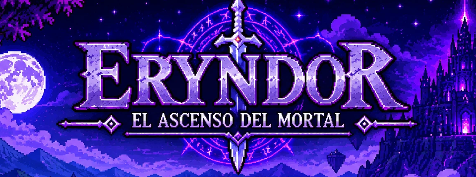
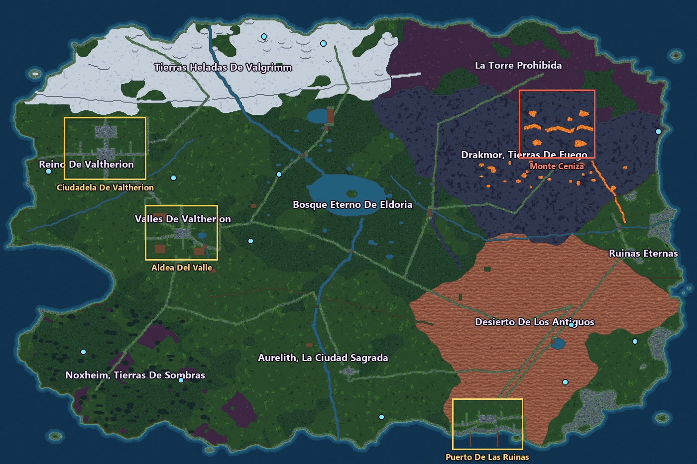
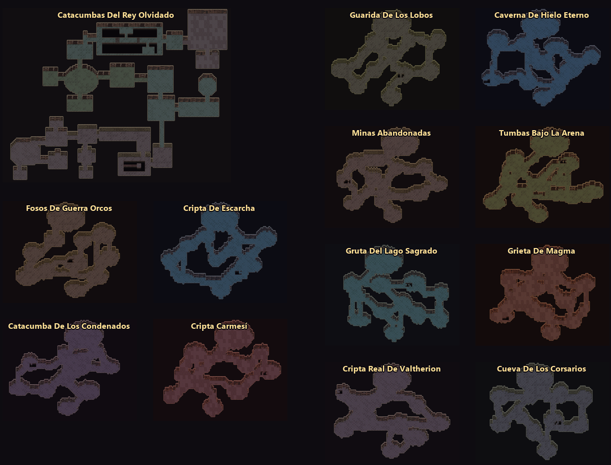
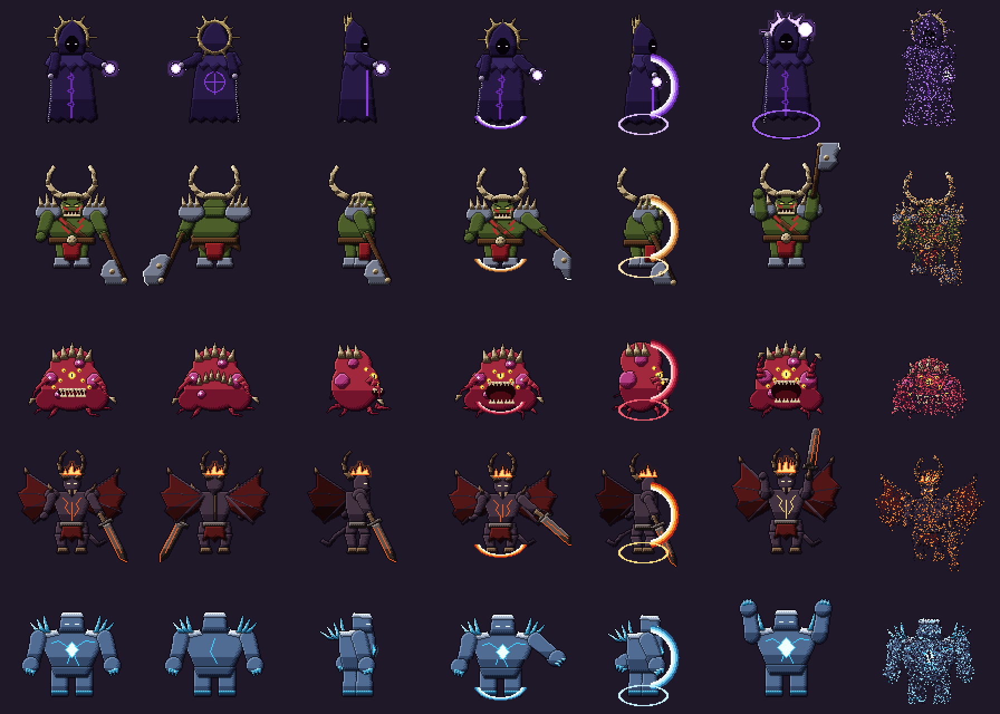
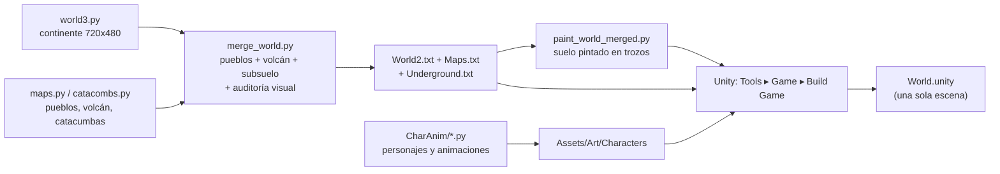
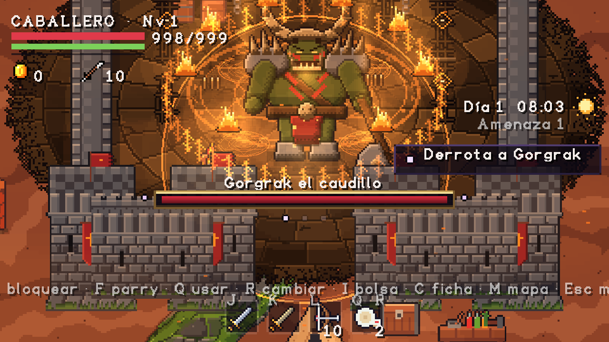
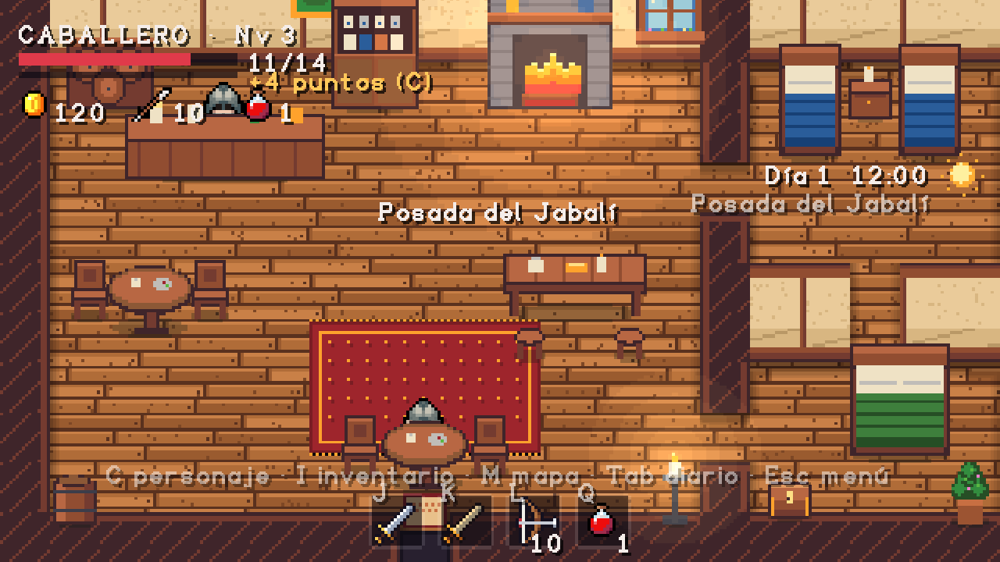
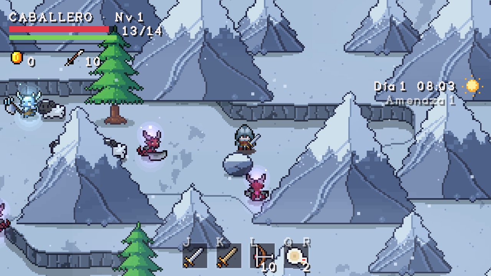

<p align="center">
  
</p>

<h1 align="center">Eryndor: El Ascenso del Mortal</h1>

<p align="center">
  <b>Action-RPG de mundo abierto en pixel art, con vista superior</b><br>
  Unity 6 (6000.6.4f1) · 2D · C# · herramientas de contenido en Python
</p>

<p align="center">
  <a href="#-cómo-jugar">Cómo jugar</a> ·
  <a href="#-el-mundo">El mundo</a> ·
  <a href="#-clases">Clases</a> ·
  <a href="#-cuevas-y-catacumbas">Cuevas</a> ·
  <a href="#-cómo-está-hecho">Cómo está hecho</a> ·
  <a href="#-estado-del-proyecto">Estado</a>
</p>

---

## 📜 De qué trata

El Señor Demonio ha corrompido el reino de **Eryndor**. Eliges un héroe entre **diez clases**, le pones nombre y sales de la
**Aldea del Valle** a un continente enorme y continuo: diez biomas, tres ciudades, un volcán sellado y un subsuelo de
**trece cuevas y catacumbas**. Todo es **un solo mapa**: caminas de la aldea al desierto, entras en una cripta o atraviesas
la Ciudadela sin pantallas de carga.

Para llegar al Señor Demonio hay que romper el **Sello de Drakmor**, y para eso derrotar a **Gorgrak el Caudillo** (bajo el
desierto) y a la **Madre de Sangre** (bajo las tierras de sombras). Por el camino esperan otros jefes, aldeas, misiones de los
vecinos, una forja, tiendas, hogueras y un ciclo de día y noche con clima propio en cada región.

| | |
|---|---|
| 🗺️ **Mapa** | 1200 × 480 casillas en una sola escena: 720 × 480 de superficie + el subsuelo |
| 🌍 **Biomas** | 10, cada uno con su terreno, su fauna de enemigos, su música, su atmósfera y su clima |
| 🏘️ **Ciudades** | Aldea del Valle, Ciudadela de Valtherion, Puerto de las Ruinas — 18 casas visitables y 18 vecinos con rutinas |
| ⚔️ **Clases** | 10, con sexo, nombre propio, atributos, equipo inicial y habilidad |
| 🕳️ **Subsuelo** | 13 cuevas y catacumbas: 5 con jefe, 8 para explorar con tesoro y guardián |
| 👹 **Jefes** | El Invocador, Gorgrak el Caudillo, la Madre de Sangre, el Coloso de Escarcha, el Rey Sepultado y el Señor Demonio |
| 🎵 **Audio** | Banda sonora original (capas de día y noche por región), ~180 efectos con variantes y sonido posicional |

---

## 🎮 Cómo jugar

### Abrir el proyecto

1. **Unity Hub → Add project from disk →** la carpeta del proyecto (`G:\Juegos`).
2. Abre `Assets/Game/Scenes/MainMenu.unity` y pulsa **Play**.
3. Si el mapa, las clases o los sprites cambiaron desde la última construcción, al pulsar Play el juego **se reconstruye solo**
   (unos minutos). También puedes hacerlo a mano: **Tools ▸ Game ▸ Build Game**.

### Controles

| Acción | Tecla |
|---|---|
| Moverse / correr | **WASD** o flechas / **Shift** |
| Ataque (pulsa de nuevo para encadenar el combo) | **J** o clic izquierdo |
| Golpe fuerte (mantén para cargarlo) | **K** o clic derecho |
| Arco (Arquera) / saeta mágica (Mago) | **L** |
| Rodar (invulnerable) | **Espacio** |
| Bloquear / parry | **Ctrl** / **F** |
| Usar, hablar, abrir, entrar, dormir | **E** |
| Objeto rápido / cambiarlo | **Q** / **R** |
| Ficha del héroe (atributos) | **C** |
| Bolsa (armas, armaduras, materiales) | **I** |
| Mapa / diario de misiones | **M** / **Tab** |
| Pausa (volumen de música y efectos) | **Esc** |

### Guardar

- **Hogueras, camas y el altar** guardan la partida y son tu punto de reaparición. **Descansar en una hoguera reinicia a los
  enemigos** (todos vuelven a la vida en su sitio; los jefes no).
- **Autoguardado** cada minuto, al volver al menú y al cerrar el juego. *Continuar* te devuelve exactamente donde estabas;
  al morir vuelves a la última hoguera (pierdes un cuarto de las monedas).

---

## 🌍 El mundo

<p align="center"></p>
<p align="center"><sub>La superficie, pintada por el generador del juego. Recuadros dorados: ciudades · rojo: Monte Ceniza · puntos azules: entradas al subsuelo.</sub></p>

| Bioma | Paisaje | Enemigos de día | Clima |
|---|---|---|---|
| **Valles de Valtherion** | praderas, granjas, la aldea de inicio | orcos, goblins, jinetes goblin, limos | lluvia |
| **Bosque Eterno de Eldoria** | bosque denso, el Gran Árbol, el lago | hombres lobo, lobos guerreros, chamanes goblin | lluvia |
| **Aurelith, la Ciudad Sagrada** | templos en ruinas, santuarios | esqueletos, lanceros, ojos vigía, brutos | lluvia |
| **Noxheim, Tierras de Sombras** | pantanos, cementerios, tierra corrupta | monstruos de sangre, tentáculos, fauces | lluvia |
| **Tierras Heladas de Valgrimm** | nieve, picos, castillo helado | orcos de hielo, lobos, minotauros | **nieve** |
| **Desierto de los Antiguos** | dunas, obeliscos, oasis | orcos del desierto, minotauros, diablillos | **tormenta de arena** |
| **Drakmor, Tierras de Fuego** | ceniza, ríos de lava, el Monte Ceniza | gólems de lava, babosas de fuego, canes infernales | **ceniza y ascuas** |
| **La Torre Prohibida** | tierra púrpura tras un portón cerrado | demonios, diablillos, lanceros oscuros | **ceniza y ascuas** |
| **Reino de Valtherion** | la Ciudadela y sus caminos reales | seguro de día; caballeros caídos de noche | lluvia |
| **Ruinas Eternas** | costa este, faro, el puerto | corsarios orcos, vikingos goblin, ballesteros | lluvia |

- **De noche** aparecen espectros y caballeros caídos (arden al amanecer) y puede surgir un **campeón**. Cuantos más
  enemigos derrotas, más sube la **amenaza**: más enemigos, más fuertes y más élites.
- **Día y noche**: 30 minutos reales de día y 30 de noche; las casas y hogueras se iluminan, y dormir salta al amanecer o al anochecer.
- Cada región tiene su **música** (con una versión nocturna que se funde con el cielo), su **ambiente** sonoro, su niebla y sus partículas.

### Ciudades

Las tres ciudades están **dentro del mundo**: sus calles se unen a los caminos y se entra caminando.

| Ciudad | Qué hay |
|---|---|
| **Aldea del Valle** | la plaza con mercado y pozo, la herrería de Bruna, la posada, molinos y campos — aquí empiezas |
| **Ciudadela de Valtherion** | murallas con torres, el cuartel, la biblioteca del sabio, la capilla, la herrería real |
| **Puerto de las Ruinas** | muelles con barcos, la posada del Jabalí, el mercader de ultramar |

Las **18 casas** se pueden visitar (E en la puerta) y los **18 vecinos** tienen nombre, oficio, rutina de día y de noche,
temas de conversación, una pregunta personal que recuerdan y un encargo.

---

## ⚔️ Clases

<p align="center"></p>

Al empezar eliges clase en un carrusel y escribes el **nombre de tu héroe**.

| Clase | Sexo | FUE | VIT | AGI | DES | DEF | Arma inicial | Habilidad |
|---|---|:-:|:-:|:-:|:-:|:-:|---|---|
| **Caballero** | H | 3 | 4 | 3 | 3 | 3 | espada larga | Versátil: +4 puntos por nivel |
| **Caballero Real** | H | 4 | 4 | 2 | 2 | 5 | espada del caballero | Baluarte: recibe 1 daño menos |
| **Cruzado** | H | 3 | 5 | 2 | 3 | 4 | lanza | Sagrado: castiga a los demonios |
| **Guerrero del Hacha** | H | 6 | 4 | 2 | 2 | 3 | hacha de guerra | Sed de sangre: cada enemigo te cura |
| **Mercenario** | H | 4 | 3 | 4 | 3 | 2 | espada corta | Codicia: +50 % de monedas |
| **Mago** | H | 2 | 3 | 3 | 6 | 2 | bastón de roble | Arcano: saetas mágicas +1 daño |
| **Espadachina** | M | 3 | 3 | 6 | 4 | 2 | estoque | Filo certero: +10 % de crítico |
| **Sacerdotisa** | M | 2 | 6 | 3 | 3 | 4 | maza sagrada | Fe: pociones +50 % y regenera vida |
| **Arquera** | M | 2 | 3 | 5 | 6 | 2 | daga + arco largo | Ojo de halcón: flechas perforantes |
| **Samurái** | H | 5 | 3 | 5 | 3 | 2 | katana | Bushido: +2 daño con katana |

**Reglas de armas:** la magia es del **Mago** (solo bastones; con **L** lanza una saeta mágica) y el arco es de la
**Arquera** (solo arcos y su daga). El resto usa cualquier arma cuerpo a cuerpo menos los bastones.

**Atributos:** *Fuerza* → daño cuerpo a cuerpo · *Vitalidad* → vida y curación · *Agilidad* → velocidad, esquiva y voltereta
· *Destreza* → daño del arco y críticos · *Defensa* → reduce cada golpe. Al subir de nivel repartes puntos en la ficha (**C**).

### Equipo

33 armas y armaduras en cuatro rarezas (común, raro, épico, legendario). Cada familia de arma se maneja distinto: espadas,
espadones, katanas, estoques, dagas, lanzas, hachas, martillos, bastones y arcos. Hay efectos elementales (fuego, veneno,
escarcha, sagrado), desgaste y reparación, mejoras en la forja hasta +5, aceites para el arma y materiales para fabricar
en las hogueras.

---

## 🕳️ Cuevas y catacumbas

<p align="center"></p>

Cada entrada del mundo baja (con un fundido a negro) a su cueva, que forma parte del mismo mapa. Bajo tierra **solo alumbran
las antorchas, los braseros y tu farol**, no llueve y la cámara muestra solo la cueva en la que estás.

| Bajo tierra | Dónde está la entrada | Qué espera dentro |
|---|---|---|
| **Catacumbas del Rey Olvidado** | Valles de Valtherion | seis zonas (cementerio, galerías, criptas, santuario, puente, trono) y **el Rey Sepultado** |
| **Fosos de Guerra Orcos** | Desierto | orcos y goblins — **Gorgrak el Caudillo** |
| **Cripta de Escarcha** | Valgrimm | orcos de hielo y esqueletos — **el Coloso de Escarcha** |
| **Catacumba de los Condenados** | Noxheim | esqueletos y segadores — **El Invocador** |
| **Cripta Carmesí** | Noxheim | monstruos de sangre — **la Madre de Sangre** |
| Guarida de los Lobos · Minas Abandonadas · Gruta del Lago Sagrado · Cripta Real · Caverna de Hielo Eterno · Tumbas bajo la Arena · Grieta de Magma · Cueva de los Corsarios | una por bioma | cuevas para explorar: enemigos del bioma, cofres y un **guardián** fuerte ante un tesoro |

---

## 👹 Enemigos y jefes

<p align="center"></p>
<p align="center"></p>

Cada enemigo tiene su forma de pelear (cargar, flanquear, disparar desde lejos, emboscar, invocar…), y los jefes pelean en
**guaridas** con su música, sus fases y su barra de vida. Los cuerpos a cuerpo telegrafían el golpe; se puede bloquear,
hacer parry y responder con un contraataque.

### Animación en cuatro direcciones

<p align="center"></p>

El juego se ve desde arriba: **todas las acciones** de los personajes (andar, atacar, bloquear, rodar, recoger, retroceder,
morir…) existen mirando **abajo, arriba, izquierda y derecha**, con el arma en la mano en cada fotograma.

---

## 🛠️ Cómo está hecho

Casi todo el contenido es **generado por código** a partir de datos, y Unity lo monta en las escenas con un solo botón.



### Regenerar el mundo

```powershell
python Tools/GameGen/world3.py G:/Juegos          # el continente (con huecos para pueblos y volcán)
python Tools/GameGen/merge_world.py G:/Juegos     # estampa pueblos, volcán y subsuelo; conecta caminos; audita
python Tools/ArtGen2/paint_world_merged.py        # pinta el suelo (unos 25 min; --caves-only: solo el subsuelo)
```

Después, en Unity, **Tools ▸ Game ▸ Build Game** (o Play, que lo hace solo si hace falta).

### Carpetas

| Ruta | Contenido |
|---|---|
| `Assets/Game/Scripts` | el juego: jugador, enemigos, combate, RPG, mundo, UI, audio |
| `Assets/Game/Editor` | el constructor de escenas y prefabs (`GameBuilder.*.cs`) y el autoreconstructor |
| `Assets/Editor/ArtPipeline` | importación de sprites (cortes, pivotes) y controladores de animación |
| `Assets/Game/Levels` | datos del mapa: `World2.txt`, `Maps.txt`, `Underground.txt`, `Interiors.txt` |
| `Assets/Art` | todo el arte: personajes, mundo, suelo pintado, utilería, interfaz, efectos |
| `Tools/GameGen` | mundo, mapas, catacumbas, música, efectos de sonido, auditoría del mapa |
| `Tools/ArtGen2` | pintores de suelo, estructuras, naturaleza, interiores, guaridas, auditoría de objetos |
| `Tools/CharAnim` | esqueletos, animaciones, variantes de color, juegos de armas, acciones de héroes, auditoría de sprites |
| `Documentation` | guía del juego, auditorías, vistas previas y capturas |

### Sistemas destacados

- **Un solo mapa con subsuelo:** las cuevas están a la derecha de la superficie en la misma escena; las entradas teletransportan
  dentro del mapa y la cámara, la luz, el clima y el mapa (M) tratan cada cueva como un gran interior.
- **Pintor de suelo por trozos** con ruido en coordenadas globales: un mapa de 11 520 × 7 680 px sin costuras entre trozos.
- **Profundidad por los pies:** todos los sprites se ordenan por su punto de apoyo, no por el centro de la imagen.
- **Animación por esqueletos** con vistas frontal y trasera dibujadas a mano, y juegos de armas completos por clase.
- **Audio adaptativo:** música por región con capa nocturna, combate, jefes, fundidos y *ducking*.

---

## ✅ Estado del proyecto

Las auditorías completas, con lo que se midió y lo que se corrigió, están en:

- [`Documentation/AUDITORIA_SPRITES.md`](Documentation/AUDITORIA_SPRITES.md) — 89 personajes y 70 juegos de armas, 11 807 animaciones
- [`Documentation/AUDITORIA_OBJETOS.md`](Documentation/AUDITORIA_OBJETOS.md) — 932 imágenes de escenario, objetos, interfaz y efectos
- [`Documentation/GUIA_DEL_JUEGO.md`](Documentation/GUIA_DEL_JUEGO.md) — la guía detallada de todos los sistemas

**Limitaciones conocidas**

- Los cambios más recientes (orden por los pies, animaciones de frente/espalda de enemigos y vecinos, pivotes, guaridas
  completas) están construidos y compilan, pero **falta probarlos jugando**.
- El juego usa **4 direcciones**; en diagonal se muestra la más cercana.
- Los **héroes dibujados** (Caballero Real, Cruzado, Mago, Espadachina…) traen del arte original unas vistas de frente y de
  espaldas muy parecidas a la de perfil.
- El nombre interno del proyecto en Unity y la guía todavía es *La Espada del Bosque*.

---

## 🖼️ Galería

<sub>Capturas de versiones de desarrollo anteriores al mapa único: el arte es el mismo, pero la interfaz y algunos lugares han cambiado.</sub>

| | |
|---|---|
|  |  |
|  |  |
|  |  |

---

## 🙏 Créditos

- **Personajes base:** *Tiny RPG Character Asset Pack* 01 (Soldier & Orc) y 02 (Demon & Blood Monster).
- **Catacumbas:** pack de **Szadi art** (dominio público).
- **Bosque:** *pixel 16 woods v2 (free)*.
- **Casillas y granja:** *Cute Fantasy*.
- Todo lo demás (mundo, pueblos, cuevas, suelo pintado, héroes animados, jefes, interfaz, música y efectos) está generado por
  las herramientas de `Tools/`.
