<p align="center">
  
</p>

<h1 align="center">Eryndor: El Ascenso del Mortal</h1>

<p align="center">
  Action-RPG de mundo abierto en pixel art con vista superior.<br>
  Unity 6 (6000.6.4f1) · 2D · C# · herramientas de contenido en Python
</p>

---

## Índice

1. [Resumen](#1-resumen)
2. [Requisitos y puesta en marcha](#2-requisitos-y-puesta-en-marcha)
3. [Controles](#3-controles)
4. [El mundo](#4-el-mundo)
5. [Ciudades](#5-ciudades)
6. [El subsuelo: cuevas y catacumbas](#6-el-subsuelo-cuevas-y-catacumbas)
7. [Clases y progresión](#7-clases-y-progresión)
8. [Combate](#8-combate)
9. [Inteligencia artificial de los enemigos](#9-inteligencia-artificial-de-los-enemigos)
10. [Población dinámica y amenaza](#10-población-dinámica-y-amenaza)
11. [Jefes](#11-jefes)
12. [Catálogo de enemigos](#12-catálogo-de-enemigos)
13. [Día, noche, clima y atmósfera](#13-día-noche-clima-y-atmósfera)
14. [Audio](#14-audio)
15. [Guardado y persistencia](#15-guardado-y-persistencia)
16. [Arquitectura técnica](#16-arquitectura-técnica)
17. [Generación de contenido](#17-generación-de-contenido)
18. [Animación y sprites](#18-animación-y-sprites)
19. [Control de calidad](#19-control-de-calidad)
20. [Estructura del repositorio](#20-estructura-del-repositorio)
21. [Estado del proyecto y limitaciones](#21-estado-del-proyecto-y-limitaciones)
22. [Créditos](#22-créditos)

---

## 1. Resumen

El Señor Demonio ha corrompido el reino de Eryndor. El jugador elige uno de diez héroes, le da un nombre y parte desde la
Aldea del Valle hacia un continente continuo: diez biomas, tres ciudades, el volcán sellado de Drakmor y un subsuelo de trece
cuevas y catacumbas. El mundo completo es **una única escena**; no hay pantallas de carga entre lugares.

El objetivo principal es romper el **Sello de Drakmor**, que solo cae cuando **Gorgrak el Caudillo** y **la Madre de Sangre**
han sido derrotados en sus guaridas subterráneas, y vencer al **Señor Demonio** en el Monte Ceniza.

| Magnitud | Valor |
|---|---|
| Tamaño del mapa | 1200 × 480 casillas (superficie 720 × 480 + subsuelo) |
| Superficie terrestre | 265 626 casillas en 10 biomas |
| Ciudades | 3, con 18 casas visitables y 18 vecinos con rutina propia |
| Subsuelo | 13 zonas: 5 con jefe y 8 de exploración |
| Clases jugables | 10 |
| Tipos de enemigo | 50 (43 colocados en el mapa, el resto por aparición dinámica o invocación) |
| Enemigos residentes | 1 719 (1 303 en superficie, 416 bajo tierra) |
| Cofres | 350 (244 en superficie, 106 bajo tierra) |
| Hogueras | 30 |
| Animaciones de personajes | 11 807 en 159 conjuntos, 54 031 fotogramas |

---

## 2. Requisitos y puesta en marcha

### Requisitos del sistema para jugar

| Componente | Mínimo | Recomendado |
|---|---|---|
| Sistema operativo | Windows 10 de 64 bits (21H1 o posterior) | Windows 11 de 64 bits |
| Procesador | 4 núcleos a 2,5 GHz (Intel Core i5 de 4.ª generación o AMD Ryzen 3 1200) | 6 núcleos a 3,0 GHz (Intel Core i5-8400 o AMD Ryzen 5 2600) |
| Memoria RAM | 8 GB | 16 GB |
| Tarjeta gráfica | DirectX 11 con 2 GB de VRAM (NVIDIA GeForce GTX 750 Ti o AMD Radeon RX 460) | DirectX 12 con 4 GB de VRAM (NVIDIA GeForce GTX 1060 o AMD Radeon RX 580) |
| Almacenamiento | 2 GB libres | 2 GB libres en SSD |
| Resolución | 1280 × 720 | 1920 × 1080 |
| Controles | teclado | teclado y ratón |

**En qué se basan estas cifras.** No se han medido todavía en equipos de referencia; se han estimado a partir de lo que el
juego carga:

- El mundo es una sola escena con unos 49 600 objetos, 48 300 sprites y 16 500 colisionadores, cargados a la vez.
- El suelo pintado son 499 texturas de 512 × 512 sin compresión, unos 500 MB de memoria de vídeo; con el resto de sprites,
  el juego necesita en torno a 700 MB de VRAM, de ahí los 2 GB mínimos.
- El procesador es el factor que más pesa: los enemigos lejanos se duermen, pero el viento anima unas 29 000 plantas y el
  motor ordena decenas de miles de sprites en cada fotograma. Las gráficas integradas pueden funcionar, pero no se
  garantiza una tasa de imágenes estable.

### Requisitos para desarrollar

| Componente | Mínimo | Recomendado |
|---|---|---|
| Motor | Unity 6000.6.4f1 (Unity Hub) | Unity 6000.6.4f1 (Unity Hub) |
| Memoria RAM | 16 GB (el editor ocupa unos 3,5 GB con el mundo abierto) | 32 GB |
| Almacenamiento | 20 GB libres (proyecto, caché de Unity y archivos de Git LFS) | 40 GB libres en SSD |
| Control de versiones | Git con Git LFS | Git con Git LFS |
| Herramientas de contenido | Python 3.11 o superior con `numpy`, `scipy` y `Pillow` | lo mismo, con 8 núcleos (el pintado del suelo se reparte entre varios procesos) |

### Instalación

```powershell
git lfs install
git clone https://github.com/TakizawaXD/ERYNDOR-El-Ascenso-del-Mortal.git
```

1. En Unity Hub: **Add project from disk** y seleccionar la carpeta clonada.
2. Abrir `Assets/Game/Scenes/MainMenu.unity` y pulsar **Play**.
3. Si el mapa, las clases o los sprites son más recientes que la última construcción, el editor reconstruye el juego
   automáticamente al pulsar Play. La construcción manual está en **Tools > Game > Build Game**.

---

## 3. Controles

| Acción | Teclado y ratón |
|---|---|
| Moverse / correr | WASD o flechas / Shift |
| Ataque ligero (repetir para encadenar el combo) | J o clic izquierdo |
| Golpe fuerte (mantener para cargarlo) | K o clic derecho |
| Arco (Arquera) / saeta mágica (Mago) | L |
| Voltereta con invulnerabilidad | Espacio |
| Bloquear / parry | Ctrl / F |
| Interactuar: hablar, abrir, entrar, dormir, descansar | E |
| Usar / cambiar objeto rápido | Q / R |
| Ficha del héroe | C |
| Bolsa (equipo y materiales) | I |
| Mapa / diario de misiones | M / Tab |
| Pausa y volumen | Esc |

---

## 4. El mundo

<p align="center"></p>
<p align="center"><sub>Figura 1. Superficie pintada por el generador. Recuadros dorados: ciudades. Recuadro rojo: Monte Ceniza. Puntos azules: entradas al subsuelo.</sub></p>

<p align="center">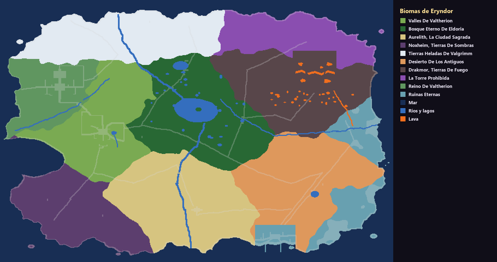</p>
<p align="center"><sub>Figura 2. División en biomas, con ríos, lagos y lava.</sub></p>

### Biomas

| Bioma | Paisaje | Fauna diurna | Fauna nocturna | Clima |
|---|---|---|---|---|
| Valles de Valtherion | praderas, granjas, la aldea de inicio | orcos, goblins, jinetes goblin, limos | espectros, caballeros caídos, hombres lobo | lluvia |
| Bosque Eterno de Eldoria | bosque denso, el Gran Árbol, el lago | hombres lobo, lobos guerreros, chamanes | hombres lobo, espectros | lluvia |
| Aurelith, la Ciudad Sagrada | templos en ruinas, santuarios | esqueletos, lanceros, ojos vigía | espectros, esqueletos, la Parca | lluvia |
| Noxheim, Tierras de Sombras | pantanos, cementerios | monstruos de sangre, tentáculos, fauces | segadores, murciélagos | lluvia |
| Tierras Heladas de Valgrimm | nieve, picos, castillo helado | orcos de hielo, lobos, minotauros | orcos de hielo, hombres lobo | nieve |
| Desierto de los Antiguos | dunas, obeliscos, oasis | orcos del desierto, minotauros, diablillos | demonios de ceniza, esqueletos | tormenta de arena |
| Drakmor, Tierras de Fuego | ceniza, ríos de lava | gólems de lava, babosas, canes infernales | canes infernales, calaveras ígneas | ceniza y ascuas |
| La Torre Prohibida | tierra corrupta tras un portón | demonios, verdugos, ojos vigía | demonios, caballeros caídos | ceniza y ascuas |
| Reino de Valtherion | la Ciudadela y el camino real | sin enemigos de día | caballeros caídos, espectros | lluvia |
| Ruinas Eternas | costa este y faro | corsarios, vikingos, ballesteros | corsarios, esqueletos | lluvia |

### Extensión de cada bioma

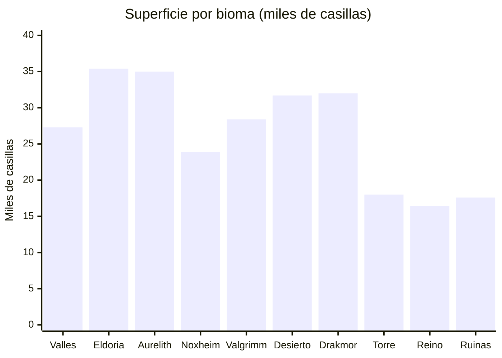

### Distribución de enemigos

<p align="center">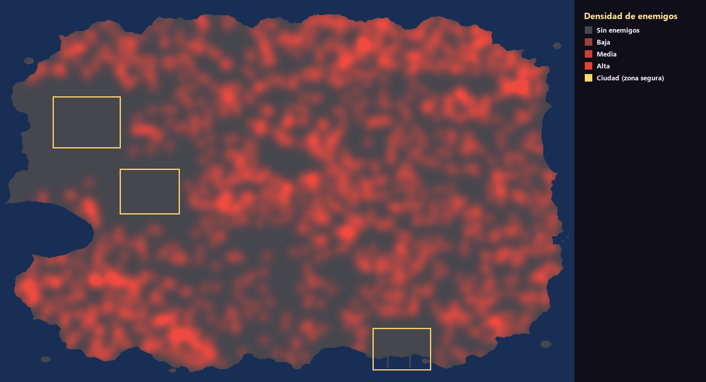</p>
<p align="center"><sub>Figura 3. Densidad de enemigos residentes. Las ciudades son zonas seguras; la presión crece hacia el este y en las tierras corruptas.</sub></p>

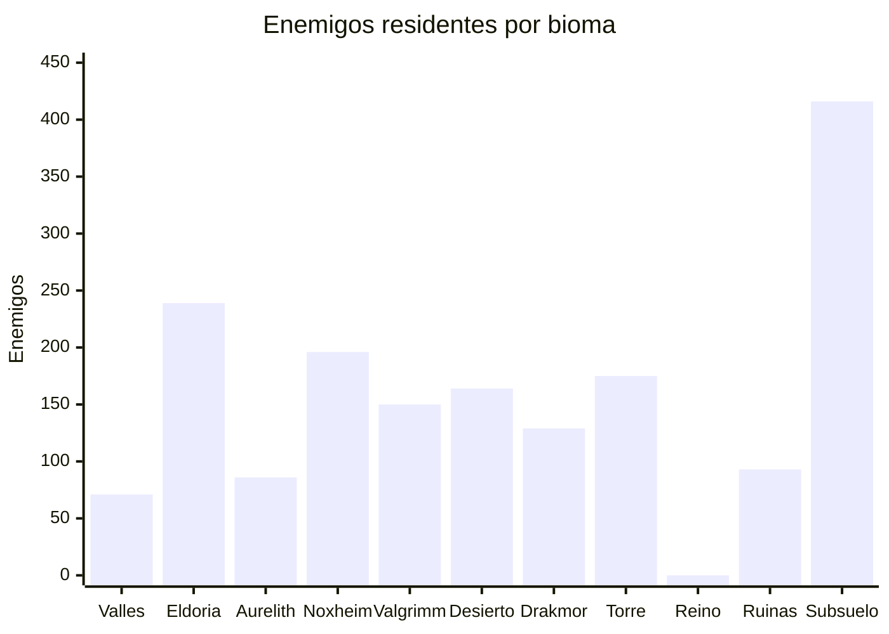

---

## 5. Ciudades

Las ciudades están integradas en el mapa: sus calles enlazan con la red de caminos y se entra caminando. Las 18 casas tienen
interior propio (E en la puerta), y los vecinos siguen una rutina de trabajo, ocio y descanso, recuerdan las respuestas del
jugador y ofrecen encargos.

| Aldea del Valle | Ciudadela de Valtherion |
|---|---|
| 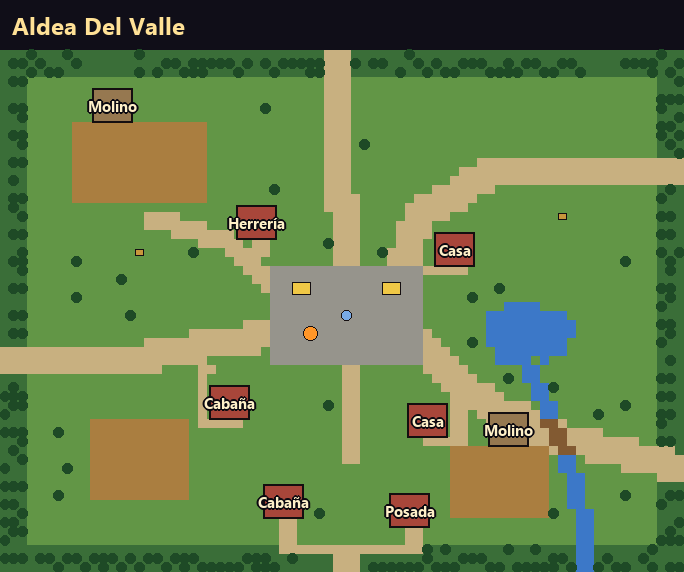 | 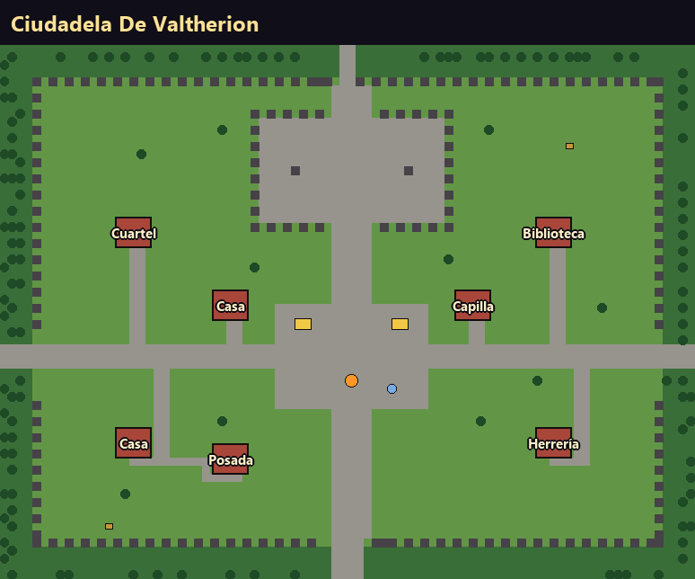 |
| **Puerto de las Ruinas** | **Monte Ceniza** |
| 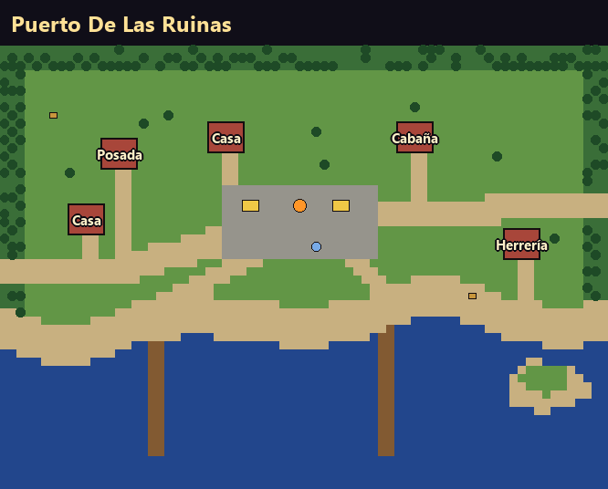 | 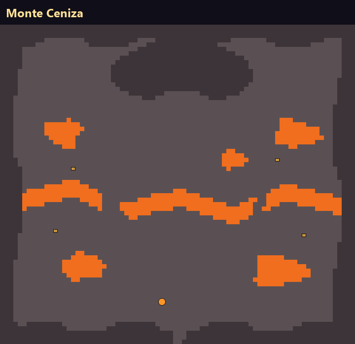 |

<sub>Figura 4. Planos generados desde los datos del mapa. Rojo: edificios (con su función). Gris: plazas y murallas. Naranja: hoguera. Amarillo: puestos de comercio. Azul claro: pozo.</sub>

| Ciudad | Servicios |
|---|---|
| Aldea del Valle | herrería de Bruna, posada, herbolaria, comerciante, molinos, campos de cultivo |
| Ciudadela de Valtherion | herrería real, cuartel, biblioteca del sabio, capilla con altar, posada, murallas y torres |
| Puerto de las Ruinas | posada del Jabalí, mercader de ultramar, muelles y barcos |

---

## 6. El subsuelo: cuevas y catacumbas

<p align="center"></p>
<p align="center"><sub>Figura 5. Las trece zonas subterráneas. Comparten escena con la superficie, a su derecha; cada entrada del mundo enlaza con su escalera.</sub></p>

| Zona | Entrada | Contenido |
|---|---|---|
| Catacumbas del Rey Olvidado | Valles de Valtherion | seis sectores (cementerio, galerías, criptas, santuario, puente, trono); jefe: el Rey Sepultado |
| Fosos de Guerra Orcos | Desierto | orcos y goblins; jefe: Gorgrak el Caudillo |
| Cripta de Escarcha | Valgrimm | orcos de hielo y esqueletos; jefe: el Coloso de Escarcha |
| Catacumba de los Condenados | Noxheim | esqueletos y segadores; jefe: El Invocador |
| Cripta Carmesí | Noxheim | monstruos de sangre; jefe: la Madre de Sangre |
| Guarida de los Lobos, Minas Abandonadas, Gruta del Lago Sagrado, Cripta Real, Caverna de Hielo Eterno, Tumbas bajo la Arena, Grieta de Magma, Cueva de los Corsarios | una por bioma | exploración: enemigos del bioma, cofres y un guardián ante el tesoro |

Las cuevas se generan con salas unidas por túneles sinuosos, suavizado por autómata celular, simas que nunca bloquean el
recorrido (se valida la conectividad desde la escalera hasta la cámara final) y decoración por temática. Bajo tierra la
iluminación es la de antorchas, braseros y el farol del jugador; no hay clima y la cámara se limita a la cueva actual.

---

## 7. Clases y progresión

<p align="center">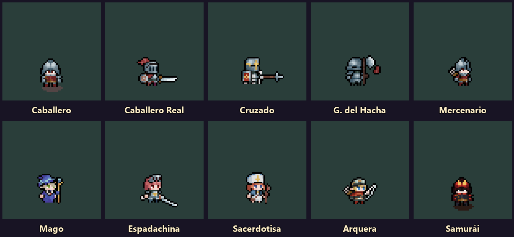</p>
<p align="center"><sub>Figura 6. Las diez clases jugables.</sub></p>

| Clase | Sexo | FUE | VIT | AGI | DES | DEF | Arma inicial | Habilidad pasiva |
|---|---|:-:|:-:|:-:|:-:|:-:|---|---|
| Caballero | H | 3 | 4 | 3 | 3 | 3 | espada larga | Versátil: +4 puntos de atributo por nivel |
| Caballero Real | H | 4 | 4 | 2 | 2 | 5 | espada del caballero | Baluarte: recibe 1 punto de daño menos |
| Cruzado | H | 3 | 5 | 2 | 3 | 4 | lanza | Sagrado: sus golpes causan daño sagrado |
| Guerrero del Hacha | H | 6 | 4 | 2 | 2 | 3 | hacha de guerra | Sed de sangre: cada enemigo derrotado le cura |
| Mercenario | H | 4 | 3 | 4 | 3 | 2 | espada corta | Codicia: +50 % de monedas |
| Mago | H | 2 | 3 | 3 | 6 | 2 | bastón de roble | Arcano: saetas mágicas +1 de daño |
| Espadachina | M | 3 | 3 | 6 | 4 | 2 | estoque | Filo certero: +10 % de probabilidad de crítico |
| Sacerdotisa | M | 2 | 6 | 3 | 3 | 4 | maza sagrada | Fe: curación +50 % y regeneración fuera de combate |
| Arquera | M | 2 | 3 | 5 | 6 | 2 | daga y arco largo | Ojo de halcón: flechas perforantes |
| Samurái | H | 5 | 3 | 5 | 3 | 2 | katana | Bushido: +2 de daño con katana |

**Restricciones de equipo.** La magia es exclusiva del Mago (solo bastones; L lanza una saeta mágica) y el arco es exclusivo
de la Arquera (arcos y dagas). El resto de clases emplea cualquier arma cuerpo a cuerpo salvo bastones.

### Fórmulas

| Valor | Fórmula |
|---|---|
| Vida máxima | 4 + 2·VIT + bonos de armadura y mejoras |
| Daño cuerpo a cuerpo | 1 + FUE/2 + daño del arma + mejoras de forja |
| Daño de arco | 1 + DES/2 + daño del arco (+1 Arquera) |
| Probabilidad de crítico | 3 % por punto de DES + bonos del arma (máximo 60 %) |
| Reducción de daño | DEF/3 + defensa de la armadura (mínimo 1 de daño recibido) |
| Esquiva | 1,2 % por punto de AGI (máximo 25 %) |
| Velocidad | +4 % por punto de AGI sobre 3 |
| Experiencia para subir | 8 + 6·(nivel − 1) |

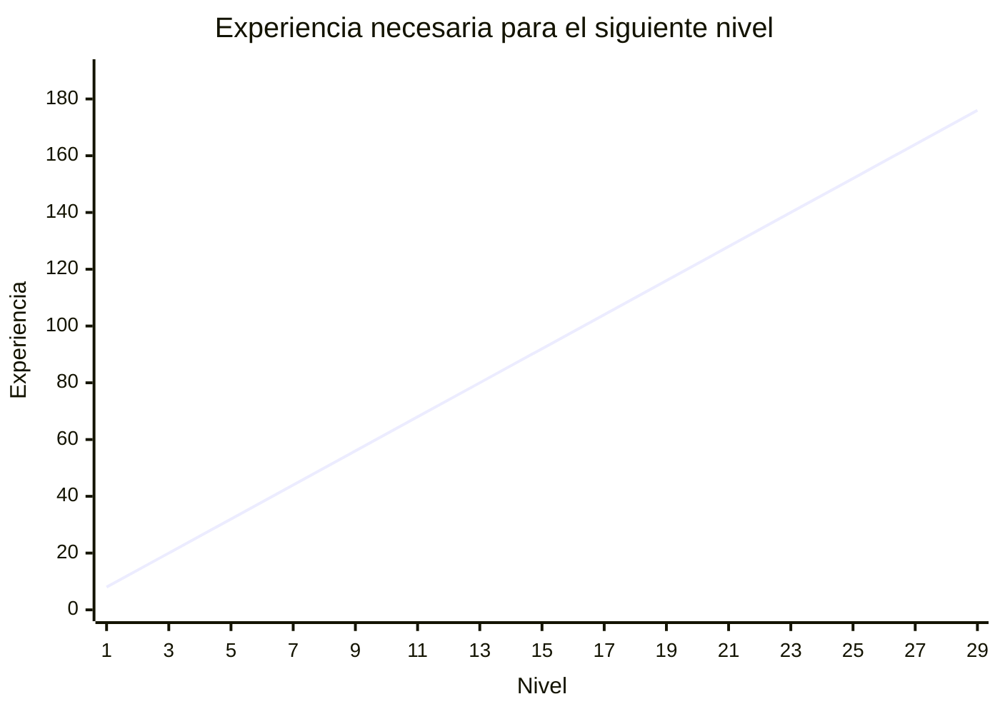

El equipo comprende 33 armas y armaduras en cuatro rarezas, con efectos elementales (fuego, veneno, escarcha, sagrado),
desgaste y reparación, mejoras de forja hasta +5, aceites para el arma y fabricación de consumibles en las hogueras.

---

## 8. Combate

- **Cadena de ataques:** ataque ligero en combo de hasta cuatro golpes (el último con más daño y empuje), golpe fuerte y
  ataque cargado que escala con el tiempo de carga.
- **Defensa:** bloqueo con coste de aguante, parry con ventana corta que aturde al atacante y abre un contraataque
  crítico, y voltereta con invulnerabilidad.
- **Aguante:** cada acción ofensiva o defensiva consume aguante; agotarlo deja al personaje vulnerable.
- **Ventanas de impacto sincronizadas con la animación:** cada ataque define anticipación, impacto, fin del impacto y
  ventana de combo mediante eventos medidos sobre los fotogramas (860 ataques analizados). Un temporizador de respaldo
  garantiza que ningún ataque quede bloqueado si falta un evento.
- **Elementos:** el fuego y el veneno dañan con el tiempo, la escarcha ralentiza y lo sagrado causa un 50 % más de daño a
  los demonios.

<p align="center">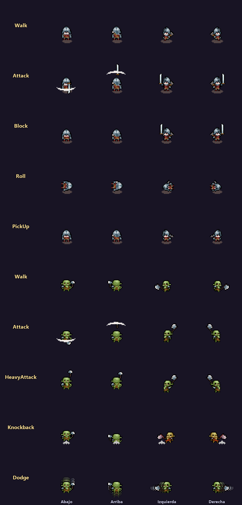</p>
<p align="center"><sub>Figura 7. Todas las acciones existen en las cuatro direcciones de la vista superior, con el arma integrada en cada fotograma.</sub></p>

---

## 9. Inteligencia artificial de los enemigos

Cada enemigo combina un **perfil de comportamiento** con sus parámetros (vida, daño, velocidad, radio de detección,
alcance, enfriamientos y ataques a distancia). El controlador es una máquina de estados evaluada en cada fotograma, con
una capa de optimización que duerme a los enemigos lejanos.

### Máquina de estados

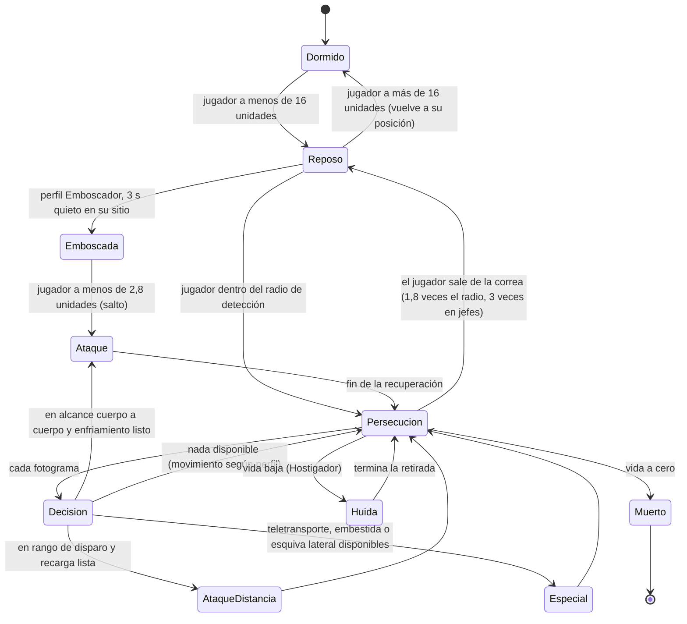

### Perfiles de comportamiento

| Perfil | Movimiento en persecución | Decisión de ataque | Ejemplos |
|---|---|---|---|
| Bruto (Brute) | avanza en línea recta | golpes pesados; difícil de empujar | orco de hielo, gólem de lava, verdugo |
| Manada (Pack) | alerta a los aliados cercanos y flanquea a 55° | ataca al llegar al alcance | orco, goblin, esqueleto, lobo guerrero |
| Hostigador (Skirmisher) | golpea y se retira; rodea al jugador mientras recarga | huye al quedar herido | orco del desierto, diablillo, murciélago |
| Tirador (Kiter) | mantiene la distancia y se desplaza lateralmente | dispara entre el alcance mínimo y el máximo | monstruo de sangre, ojo vigía, ballestero |
| Lanzador (Caster) | mantiene la distancia | se teletransporta alrededor del jugador y lanza ráfagas | demonio, chamán goblin, Señor Demonio |
| Emboscador (Ambusher) | permanece oculto (casi invisible) | salta sobre el jugador cuando pasa cerca | limo verde, limo tóxico, tentáculo |
| Embestidor (Charger) | carga y embiste en línea recta a 2,2–6,5 unidades | embestida con preparación visible | berserker, minotauro, can infernal, Gorgrak |
| Espectro (Wraith) | flota atravesando muros en trayectoria ondulante | se desvanece tras golpear; arde al amanecer | espectro, la Parca |
| Duelista (Duelist) | se mantiene a media distancia al recargar | bloquea, esquiva en lateral un 50 % de los golpes y contraataca | caballero caído, lancero oscuro, segador |
| Bombardero (Bomber) | mantiene la distancia | explota al morir | engendro de magma, babosa de fuego |

### Mecanismos comunes

- **Detección y correa:** el enemigo reacciona dentro de su radio de detección (entre 4 y 9 unidades según tipo) y sigue
  persiguiendo hasta 1,8 veces ese radio (3 veces en los jefes) antes de rendirse.
- **Antiatascos:** si el enemigo no avanza mientras intenta moverse, se desliza lateralmente un instante; los tiradores
  atascados atacan cuerpo a cuerpo.
- **Telegrafía:** los golpes cuerpo a cuerpo tienen una fase de anticipación visible y sonora, lo que permite bloquear,
  hacer parry o esquivar.
- **Furia:** los jefes por debajo del 50 % de vida se mueven un 35 % más rápido.
- **Rendimiento:** a más de 16 unidades del jugador el enemigo se duerme (sin IA, animación ni física) y los residentes
  vuelven a su posición inicial.
- **Ciclo diario:** los residentes diurnos duermen de noche fuera de la vista del jugador; las criaturas nocturnas arden
  al amanecer.

### Reparto de perfiles en el mapa

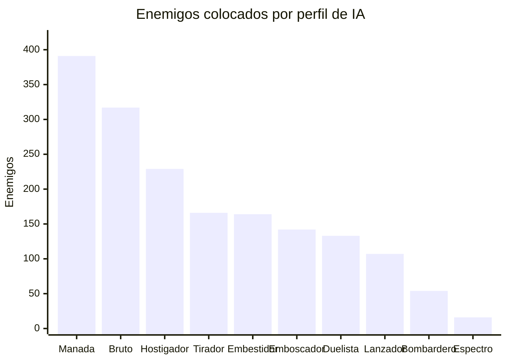

---

## 10. Población dinámica y amenaza

Además de los residentes, el **director de aparición** genera enemigos del bioma alrededor del jugador (entre 11 y 15
unidades de distancia, nunca dentro de una ciudad ni a través de la roca de una cueva) y retira los rezagados lejanos. Su
intensidad depende del **nivel de amenaza**, que crece con las muertes del jugador: `amenaza = 1 + muertes / 12` (máximo 10).

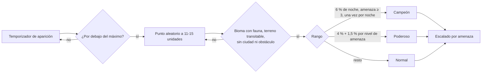

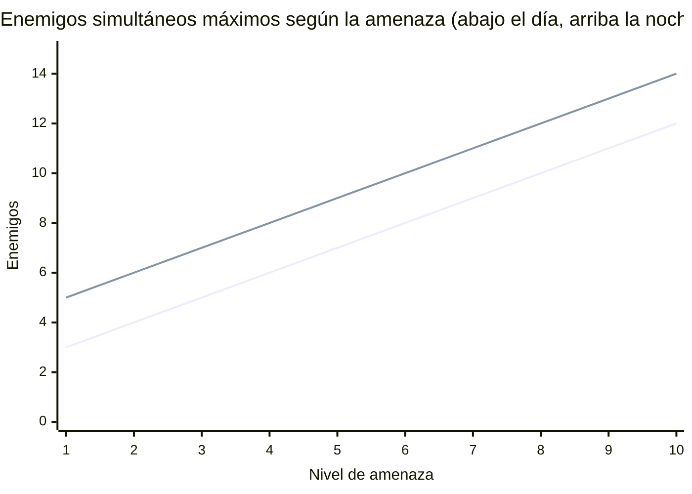

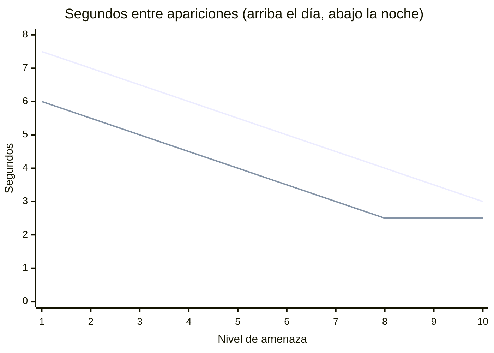

### Escalado por rango

| Rango | Vida | Daño | Experiencia | Monedas | Otros |
|---|---|---|---|---|---|
| Normal | ×(1 + 0,12·(amenaza − 1)) | + (amenaza − 1)/3 | ×(1 + 0,1·(amenaza − 1)) | base | — |
| Poderoso | ×2,5 adicional | +1 + daño/2 | ×3 | ×3 + 3 | 25 % más grande, resiste el empuje |
| Campeón | ×5 adicional | +2 + daño/2 | ×8 | ×6 + 10 | 50 % más grande, barra de jefe, poción garantizada |

---

## 11. Jefes

<p align="center"></p>
<p align="center"><sub>Figura 8. Los jefes principales.</sub></p>

Los jefes usan el controlador común (persecución, golpes y disparos) más una capa de **fases**: la segunda fase empieza al
66 % de vida y la tercera al 33 %; cada fase añade ataques y acorta la pausa entre ellos. Cada jefe pelea en una guarida con
su iluminación, su niebla, su música y obstáculos propios.

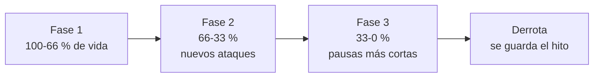

| Jefe | Guarida | Vida | Daño | Ataques característicos |
|---|---|:-:|:-:|---|
| Gorgrak el Caudillo | Fosos de Guerra Orcos | 55 | 3 | ondas de choque, llamada a saqueadores, hachas lanzadas en abanico |
| Madre de Sangre | Cripta Carmesí | 55 | 2 | anillos de escupitajos, limos tóxicos, espiral |
| Coloso de Escarcha | Cripta de Escarcha | 80 | 4 | ondas heladas, carámbanos que caen, estallidos de hielo |
| El Invocador | Catacumba de los Condenados | 60 | 3 | orbes en abanico, anillos de almas, espiral y esbirros |
| Señor Demonio | Monte Ceniza | 70 | 3 | abanicos de fuego, meteoros sobre el jugador, espiral ígnea, diablillos |

---

## 12. Catálogo de enemigos

<p align="center">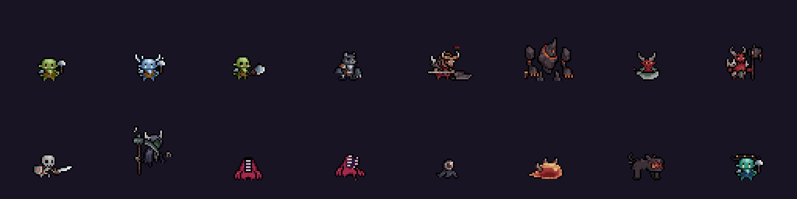</p>
<p align="center"><sub>Figura 9. Selección de enemigos.</sub></p>

<details>
<summary><b>Tabla completa de los 50 tipos (valores base, sin escalado)</b></summary>

| Enemigo | Perfil | Vida | Daño | Velocidad | Detección | Exp. |
|---|---|:-:|:-:|:-:|:-:|:-:|
| Orco | Manada | 6 | 2 | 2,4 | 4,5 | 3 |
| Orco corsario | Manada | 8 | 2 | 2,6 | 5,5 | 5 |
| Orco del desierto | Hostigador | 7 | 2 | 2,9 | 5,5 | 4 |
| Orco de hielo | Bruto | 13 | 3 | 2,0 | 5,0 | 6 |
| Orco berserker | Embestidor | 11 | 3 | 2,6 | 6,0 | 7 |
| Goblin | Manada | 6 | 1 | 2,7 | 5,5 | 3 |
| Goblin vikingo | Bruto | 11 | 2 | 2,1 | 5,5 | 6 |
| Jinete goblin | Embestidor | 12 | 3 | 3,2 | 7,0 | 8 |
| Chamán goblin | Lanzador | 8 | 2 | 2,0 | 7,0 | 7 |
| Hombre lobo | Bruto | 16 | 3 | 3,0 | 6,5 | 9 |
| Lobo guerrero | Manada | 10 | 2 | 2,8 | 6,0 | 6 |
| Minotauro | Embestidor | 24 | 4 | 2,6 | 7,0 | 14 |
| Bruto del escudo | Bruto | 22 | 3 | 1,7 | 5,5 | 11 |
| Lancero oscuro | Duelista | 14 | 3 | 2,3 | 6,5 | 9 |
| Caballero caído | Duelista | 13 | 3 | 2,7 | 6,5 | 9 |
| Esqueleto | Manada | 7 | 2 | 2,3 | 6,0 | 4 |
| Esqueleto hachero | Embestidor | 12 | 3 | 2,4 | 6,5 | 8 |
| Esqueleto lancero | Duelista | 11 | 3 | 2,3 | 6,0 | 8 |
| Esqueleto guerrero | Bruto | 12 | 3 | 2,0 | 6,0 | 8 |
| Segador | Duelista | 13 | 3 | 2,5 | 6,5 | 9 |
| La Parca | Espectro | 14 | 4 | 2,6 | 8,0 | 12 |
| Espectro | Espectro | 7 | 2 | 3,0 | 7,5 | 6 |
| Limo verde | Emboscador | 6 | 1 | 2,0 | 4,0 | 3 |
| Limo tóxico | Emboscador | 6 | 2 | 2,4 | 4,5 | 4 |
| Tentáculo | Emboscador | 10 | 2 | 1,8 | 4,5 | 6 |
| Fauces | Hostigador | 8 | 3 | 3,0 | 6,0 | 6 |
| Monstruo de sangre | Tirador | 5 | 1 | 2,0 | 5,5 | 3 |
| Engendro de magma | Bombardero | 8 | 2 | 2,1 | 6,0 | 6 |
| Babosa de fuego | Bombardero | 9 | 2 | 1,4 | 6,0 | 6 |
| Calavera ígnea | Tirador | 7 | 2 | 2,6 | 8,0 | 7 |
| Ojo vigía | Tirador | 9 | 2 | 1,8 | 9,0 | 7 |
| Gólem de lava | Bruto | 30 | 5 | 1,5 | 6,0 | 18 |
| Can infernal | Embestidor | 12 | 3 | 3,6 | 7,5 | 9 |
| Murciélago | Hostigador | 4 | 1 | 3,4 | 6,0 | 2 |
| Murciélago infernal | Hostigador | 6 | 2 | 3,6 | 7,0 | 4 |
| Demonio | Lanzador | 9 | 2 | 2,6 | 5,5 | 6 |
| Demonio de ceniza | Bruto | 15 | 3 | 2,3 | 6,0 | 9 |
| Verdugo demoníaco | Bruto | 18 | 4 | 2,0 | 6,0 | 11 |
| Gran demonio alado | Lanzador | 22 | 4 | 2,2 | 8,0 | 16 |
| Reina demonio | Lanzador | 20 | 3 | 2,0 | 8,0 | 16 |
| Diablillo | Hostigador | 6 | 2 | 3,0 | 6,0 | 4 |
| Diablillo alado | Hostigador | 7 | 2 | 3,2 | 7,0 | 5 |
| Diablillo de cadenas | Manada | 8 | 2 | 2,9 | 6,5 | 5 |
| Diablillo ballestero | Tirador | 6 | 2 | 2,4 | 7,5 | 5 |
| Enjambre de diablillos | Manada | 14 | 2 | 2,6 | 6,5 | 9 |
| Gorgrak el Caudillo (jefe) | Embestidor | 55 | 3 | 2,3 | 6,5 | 40 |
| Madre de Sangre (jefe) | Tirador | 55 | 2 | 2,0 | 7,0 | 40 |
| Coloso de Escarcha (jefe) | Bruto | 80 | 4 | 1,7 | 7,0 | 70 |
| El Invocador (jefe) | Lanzador | 60 | 3 | 1,9 | 7,5 | 50 |
| Señor Demonio (jefe) | Lanzador | 70 | 3 | 2,2 | 7,0 | 60 |

</details>

---

## 13. Día, noche, clima y atmósfera

- **Ciclo diario:** 30 minutos reales de día y 30 de noche. Amanecer y atardecer tiñen la escena; de noche se encienden
  hogueras, antorchas, ventanas y el farol del jugador. Dormir salta al amanecer o al anochecer.
- **Clima por bioma:** chubascos periódicos (de 1 a 2,5 minutos tras 2,5 a 5,5 minutos de calma) cuya precipitación depende
  del bioma: lluvia con salpicaduras y relámpagos, nieve, tormenta de arena horizontal o lluvia de ceniza con ascuas. La
  vegetación se mece con viento y ráfagas.
- **Atmósfera por zona:** cada bioma y cada sector subterráneo define tinte, niebla y partículas (hojas, nieve, arena,
  ascuas, esporas, polvo en suspensión).

---

## 14. Audio

- Banda sonora original compuesta por código: una pieza por región y por ciudad, cada una con una **capa nocturna** que se
  funde con la oscuridad del cielo; piezas de combate, combate de élite, jefes, interiores y fanfarrias.
- Transiciones con fundido cruzado, retorno a la pieza de la zona al terminar el combate y atenuación (*ducking*) con menús
  y fanfarrias.
- Unos 180 efectos con dos o tres variantes, tono aleatorio y sonido posicional; pasos según el suelo, voces de enemigos por
  especie y ambientes por bioma.

---

## 15. Guardado y persistencia

| Mecanismo | Comportamiento |
|---|---|
| Hogueras, camas y altar | guardan la partida y fijan el punto de reaparición; las hogueras además reinician a los enemigos (excepto jefes) |
| Autoguardado | cada 60 segundos, al volver al menú y al cerrar el juego; *Continuar* restaura la posición exacta |
| Muerte | reaparición en el último punto de descanso con la pérdida de un cuarto de las monedas |
| Enemigos derrotados | cada residente vuelve una hora de juego después de morir |
| Compatibilidad | las partidas de versiones con mapas separados se trasladan a la posición equivalente del mapa único |

---

## 16. Arquitectura técnica

```mermaid
flowchart TB
    subgraph Datos["Datos del mundo (Assets/Game/Levels)"]
        W2["World2.txt<br/>terreno, entidades, regiones"]
        MP["Maps.txt<br/>ciudades, cuevas, puertas"]
        UG["Underground.txt"]
    end
    subgraph Editor["Editor de Unity"]
        GB["GameBuilder<br/>escena, prefabs, recursos"]
        AP["ArtPipeline<br/>importación y animadores"]
        AR["AutoRebuild<br/>reconstrucción al pulsar Play"]
    end
    subgraph Juego["Juego en ejecución"]
        GM["GameManager<br/>flujo, guardado, teletransporte"]
        WI["WorldInfo<br/>regiones, ciudades, cuevas"]
        PC["PlayerController"]
        EC["EnemyController + BossBrain"]
        SD["SpawnDirector"]
        ENV["DayNight, WeatherSystem,<br/>ZoneAtmosphere"]
        AU["MusicDirector, AmbienceDirector, Sfx"]
        UI["Hud, WorldUI, menús"]
    end
    Datos --> GB
    AP --> GB
    AR --> GB
    GB --> Juego
    WI --> SD
    WI --> ENV
    WI --> AU
    PC --> EC
```

| Sistema | Archivos principales |
|---|---|
| Flujo, guardado, teletransporte dentro del mapa | `Scripts/Flow/GameManager*.cs`, `Scripts/Flow/MapDB.cs` |
| Información espacial (biomas, ciudades, cuevas, límites de cámara) | `Scripts/World/WorldInfo.cs`, `Scripts/Flow/CameraFollow.cs` |
| Jugador y combate | `Scripts/Actors/PlayerController.cs`, `Scripts/Combat/*` |
| Enemigos, jefes e invocaciones | `Scripts/Actors/EnemyController.cs`, `BossBrain.cs`, `SummonerBoss.cs` |
| Población dinámica | `Scripts/World/SpawnDirector.cs` |
| Clima, luz y atmósfera | `Scripts/World/WeatherSystem.cs`, `DayNightLighting.cs`, `ZoneAtmosphere.cs` |
| RPG: clases, estado, objetos, vecinos | `Scripts/RPG/*` |
| Construcción de la escena | `Editor/GameBuilder*.cs`, `Editor/AutoRebuild.cs` |

**Decisiones de diseño relevantes**

- **Un solo mapa con subsuelo lateral.** Las cuevas ocupan la misma escena a la derecha de la superficie; las entradas
  teletransportan dentro del mapa sin recargar. Cámara, luz, clima, música y mapa en pantalla consultan si el jugador está
  bajo tierra y en qué cueva.
- **Orden de profundidad por los pies.** Todos los sprites se ordenan por su punto de apoyo, no por el centro de la imagen,
  de modo que personajes y objetos se superponen correctamente.
- **Rendimiento en mundo abierto.** Enemigos dormidos fuera de 16 unidades, colisiones compuestas sin las celdas interiores
  de roca y mar, y efectos de clima que siguen a la cámara con coste constante.

---

## 17. Generación de contenido

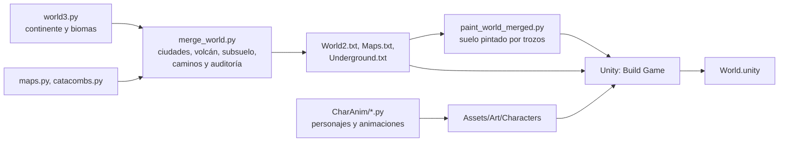

```powershell
python Tools/GameGen/world3.py G:/Juegos
python Tools/GameGen/merge_world.py G:/Juegos
python Tools/ArtGen2/paint_world_merged.py
```

- **Continente:** ruido fractal para la costa, regiones crecidas desde semillas, cordilleras con pasos, ríos, lagos, lava,
  caminos, puntos de interés, llaves y atajos.
- **Fusión:** las ciudades y el Monte Ceniza se estampan en sus huecos; cada puerta de ciudad se conecta con el camino más
  cercano mediante búsqueda de coste mínimo (con puentes sobre el agua); se colocan la fauna de cada bioma y las trece zonas
  subterráneas.
- **Suelo pintado:** se pinta por bloques de 120 × 100 casillas con ruido en coordenadas globales, de forma que los bloques
  encajan sin costuras en una imagen de 11 520 × 7 680 píxeles para la superficie.
- **Imágenes de este documento:** `python Tools/readme_images.py` regenera los mapas, planos y láminas a partir del estado
  actual del juego.

---

## 18. Animación y sprites

- **Personajes por esqueleto:** el Soldado, el Orco, el Demonio y el Monstruo de Sangre se construyen con vistas frontal y
  trasera dibujadas a mano y animadas con el mismo lenguaje de tiempos; sus variantes de color generan las clases, los
  vecinos y los enemigos regionales.
- **Juegos de armas:** once familias de armas con 36 animaciones cada una (cuatro direcciones), con la empuñadura en la mano
  en cada fotograma.
- **Héroes dibujados:** nueve personajes con arte propio, completados con 77 animaciones derivadas de sus fotogramas para
  las acciones que no traían.
- **Integración con el motor:** cortes y pivotes leídos de la lista de animaciones de cada personaje, controladores con
  árboles de mezcla direccionales y eventos de animación para golpes, combos y proyectiles.

---

## 19. Control de calidad

| Auditoría | Alcance | Documento |
|---|---|---|
| Sprites y animaciones | 89 personajes y 70 juegos de armas, 11 807 animaciones, 54 031 fotogramas | [AUDITORIA_SPRITES.md](Documentation/AUDITORIA_SPRITES.md) |
| Objetos, escenario, interfaz y efectos | 932 imágenes, referencias del código y colisiones | [AUDITORIA_OBJETOS.md](Documentation/AUDITORIA_OBJETOS.md) |
| Mapa | solapes con edificios, objetos en caminos o en el agua, accesos bloqueados | `Tools/GameGen/audit_world.py` (se ejecuta en cada fusión) |
| Compilación | código del juego y del editor contra los ensamblados de Unity | `Tools/GameGen/compile_check.sh` |
| Pruebas automáticas | suite de Unity Test Runner | `Assets/Game/Tests` |

La guía detallada de todos los sistemas está en [GUIA_DEL_JUEGO.md](Documentation/GUIA_DEL_JUEGO.md).

---

## 20. Estructura del repositorio

| Ruta | Contenido |
|---|---|
| `Assets/Game/Scripts` | código del juego |
| `Assets/Game/Editor` | constructor de escenas y prefabs, reconstrucción automática |
| `Assets/Editor/ArtPipeline` | importación de sprites y construcción de animadores |
| `Assets/Game/Levels` | datos del mapa |
| `Assets/Game/Audio` | música, ambientes y efectos |
| `Assets/Art` | arte: personajes, mundo, suelo pintado, utilería, interfaz, efectos |
| `Tools/GameGen` | mundo, fusión, catacumbas, música, efectos, auditoría del mapa |
| `Tools/ArtGen2` | pintores de suelo, estructuras, naturaleza, interiores, guaridas, auditoría de objetos |
| `Tools/CharAnim` | esqueletos, animaciones, variantes, armas, acciones de héroes, auditoría de sprites |
| `Documentation` | guía, auditorías, láminas y capturas |

---

## 21. Estado del proyecto y limitaciones

**Estado.** El juego compila y su escena se construye sin errores. Los cambios más recientes (orden de profundidad por los
pies, animaciones frontales y traseras de enemigos y vecinos, pivotes corregidos y guaridas completas) están construidos y
pendientes de verificación jugando.

**Limitaciones conocidas**

- El juego trabaja con cuatro direcciones; en diagonal se muestra la más cercana.
- Las vistas frontal y trasera de los héroes dibujados proceden de su arte original y son muy similares a la de perfil.
- El nombre interno del proyecto en Unity es todavía *La Espada del Bosque*.
- La primera generación completa del suelo pintado tarda unos 25 minutos.

<details>
<summary><b>Capturas de versiones de desarrollo</b></summary>

Capturas anteriores al mapa único: el arte coincide, pero la interfaz y algunos lugares han cambiado.

| | |
|---|---|
| 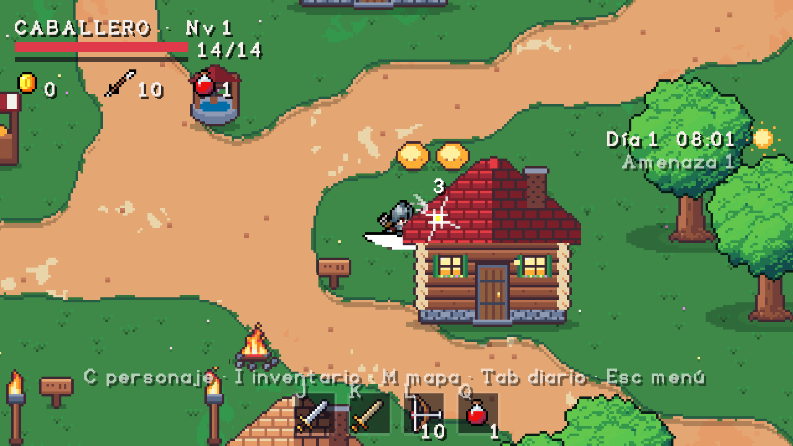 |  |
|  |  |
| 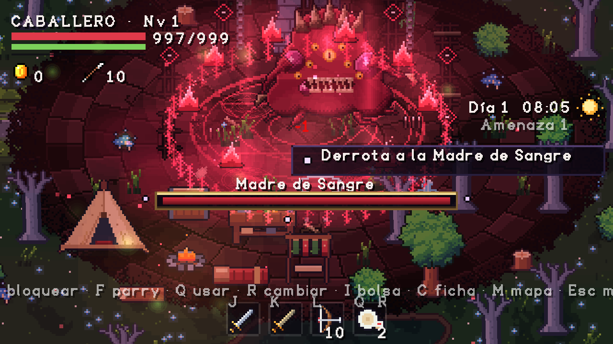 | 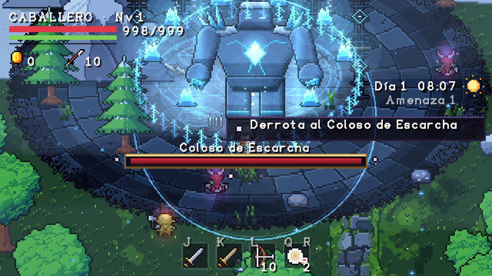 |

</details>

---

## 22. Créditos

- Personajes base: *Tiny RPG Character Asset Pack* 01 (Soldier & Orc) y 02 (Demon & Blood Monster).
- Catacumbas: paquete de Szadi art (dominio público).
- Bosque: *pixel 16 woods v2 (free)*.
- Casillas y granja: *Cute Fantasy*.
- El resto del contenido (mundo, ciudades, cuevas, suelo pintado, héroes animados, jefes, interfaz, música y efectos) se
  genera con las herramientas incluidas en `Tools/`.
